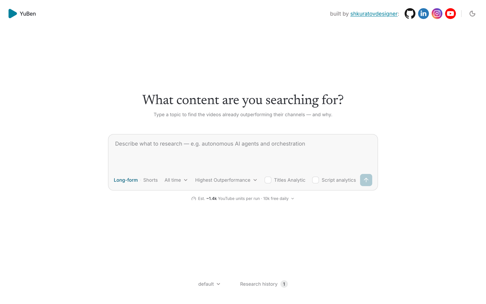
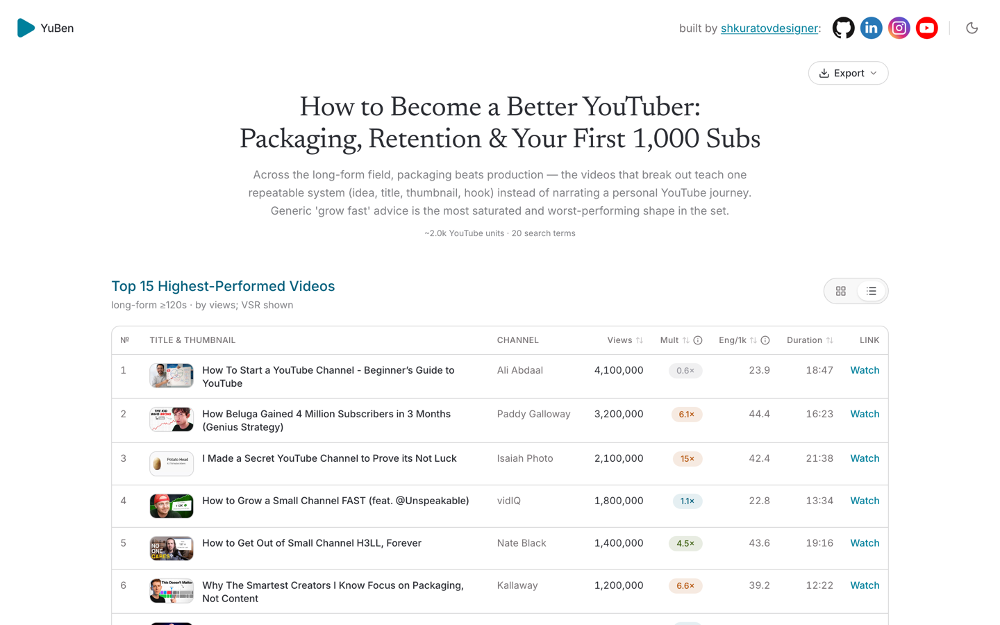
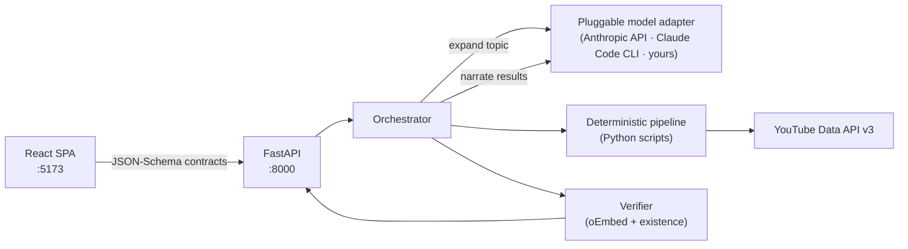

<div align="center">

<picture>
  <source media="(prefers-color-scheme: dark)" srcset="docs/assets/logo-dark.svg">
  
</picture>

### Find the YouTube videos that massively outperform their channels — and learn exactly why.

[](LICENSE)
[](https://github.com/shkuratovdesigner/yuben-app/actions/workflows/ci.yml)
[](backend/pyproject.toml)
[](frontend/package.json)
[](backend/app/main.py)
[](#your-keys-stay-on-your-machine)


<sub><b>Demo data.</b> Video IDs, titles and channels are real; view, subscriber and like counts are representative sample values, not live API readings.</sub>

</div>

---

**YuBen** is a local-first web app for YouTube content research. Type a topic and it finds *outlier* videos — ones that earn far more views than their channel's subscriber count predicts — then explains what makes them win: a ranked watch list, title-pattern analysis, and a concrete game plan for your own video.

The core signal is **VSR (views ÷ subscribers)**. In the demo run above, a 140k-subscriber channel pulled 2.1M views (15×) while a 6.2M-subscriber channel managed 4.1M on the same topic (0.6×) — the multiple, not the raw view count, tells you the *idea* carried the video rather than the audience. Those are the videos worth studying.

## How it works

<div align="center">

</div>

1. **Describe a topic** and pick your filters — long-form or Shorts, upload window, outperformance tier (any / 2× / 5× / highest).
2. **The pipeline researches deterministically.** An LLM agent expands your topic into ~20 search terms, then Python scripts query the YouTube Data API, compute VSR and engagement, filter out promoted/dead-engagement videos, and rank the outliers.
3. **The agent narrates, the backend verifies.** The LLM writes the summary, watch-list reasoning, and title/script analysis — but every video ID, view count, and link is re-checked against the script output and YouTube oEmbed before it renders.

> **The trust rule (non-negotiable):** all numbers and video IDs come from the deterministic pipeline JSON and are re-verified by the backend. The LLM supplies *narrative only* — the app never renders a video ID the model typed. LLMs are great at prose and terrible at not inventing plausible-looking YouTube links; YuBen is built around that fact. See [docs/PRD.md](docs/PRD.md) §8.

## Features

- **Outlier discovery** — VSR-ranked results with engagement sanity checks: under 1.5 likes per 1,000 views reads as bought or ad-driven traffic, so the video is dropped from the ranking and the count of what was dropped is reported in the run's `counts.promoted_excluded`.
- **Region preference** — YouTube search offers only soft relevance hints (`regionCode`, `relevanceLanguage`), and `en` alone will not narrow a topic to the US/EU. YuBen also reads each channel's self-declared country and sorts US/UK/CA/AU/IE/NZ first, then Europe, then channels that declared nothing, then the rest. It is a preference, never a filter — the field is optional on YouTube's side, so dropping on it would silently delete legitimate channels. Tune the regions in [`backend/app/pipeline/params.py`](backend/app/pipeline/params.py).
- **Recommended watch list** — a short, sequenced list of what to watch and what to take from each video.
- **Grid or sortable table** — switch views, then sort by views, VSR multiple, engagement or duration. Each row keeps its original outlier rank, so re-sorting never restates the ranking.
- **Title & script analysis** — common patterns, emotional triggers, and hook structures across the outlier set, with per-video transcripts when enabled.
- **Bring your own model** — the LLM sits behind a small pluggable adapter interface, not a hardcoded vendor. Thirteen adapters ship: Anthropic, OpenAI, Google Gemini, OpenRouter (~350 models on one key) and Ollama (local, free, no key) connect with a paste or nothing at all; Claude Code, Codex, Cursor, opencode and friends use a CLI you already have. See [Model adapters](#model-adapters).
- **Quota-aware** — shows the estimated YouTube API units before each run (~1.4k of the free 10k daily).
- **Research history & export** — every run is stored locally (SQLite) and exportable.
- **Mock-first UI** — the entire interface runs on bundled fixtures with no backend and no keys, so you can explore it in one command.
- **Dark & light mode**, responsive, keyboard-accessible.

<div align="center">

</div>

## Quickstart

Install [Node.js 22 LTS or newer](https://nodejs.org/) if you do not already have it, then run the same command on **macOS, Windows or Linux**:

```bash
npx https://github.com/shkuratovdesigner/yuben-app/releases/latest/download/yuben-app.tgz
```

Accept npm's package-install prompt. YuBen downloads a private Python runtime and its dependencies on the first launch, starts locally and opens your browser. No Git clone, manual Python installation or frontend build is needed. First launch needs internet access and can take a few minutes; later launches reuse the installed runtime.

Run the same command to reopen YuBen. Keep the terminal open while using it; **Ctrl+C** stops the server. It starts at `http://localhost:8000`, or the next free port if that is occupied. The app runs on your machine; research connects to YouTube and your chosen model provider.

> **Short npm command:** `npx yuben-app@latest` is prepared but not published yet. The first npm publication is waiting on maintainer account 2FA. Use the GitHub-release command above until then.

### Options and saved data

Append `--no-browser` to start without opening a tab, or `--help` for options. Set `YUBEN_PORT` to pin a port; a busy pinned port is an error.

History, settings and fallback key files live outside npm's cache:

| Platform | Default data folder |
|---|---|
| macOS | `~/Library/Application Support/YuBen/data` |
| Windows | `%LOCALAPPDATA%\YuBen\data` |
| Linux | `~/.local/share/yuben/data` (or `$XDG_DATA_HOME/yuben/data`) |

`YUBEN_DATA_DIR` overrides the data folder. `YUBEN_HOME` overrides the private runtime and default data parent. Updating the package or clearing npm's cache does not delete your history.

**Moving from a source checkout:** stop the old server and set `YUBEN_DATA_DIR` to the absolute path of its `backend/.yuben` folder before starting the npx version. This reuses its history and fallback keys without moving or overwriting anything. OS-keychain entries remain available under the same user account. Without this override, the npx version starts with a separate data folder.

Supported packaged targets: Apple Silicon/Intel macOS, x64/ARM64 Windows with `tar` (Windows 10+), and x64/ARM64 glibc Linux with `tar`. Other systems can use the source workflow below.

### Run from source

For contributors or a local checkout, install **Python 3.10+**, **Git**, and **Node 20.19+ or 22.12+**, then:

```bash
git clone https://github.com/shkuratovdesigner/yuben-app.git
cd yuben-app
python3 yuben.py start
```

On Windows, use `py yuben.py start`. You can also double-click `start.command` on macOS or `start.cmd` on Windows. Debian/Ubuntu may need the matching `python3-venv` package.

The source launcher installs dependencies on first run and builds the frontend before serving it. `python yuben.py dev` starts Vite with hot reload on `:5173` and the backend as a pair. The packaged npx version ships the built interface and skips these development steps.

### Connect YouTube and a model

To do real research, connect two things in the app's onboarding flow:

| What | Used for | Where to get it |
|---|---|---|
| YouTube Data API v3 key | search + video/channel stats | [Google Cloud Console](https://console.cloud.google.com/) → create a project → *APIs & Services* → *Library* → enable **YouTube Data API v3** → *Credentials* → *Create credentials* → *API key* |
| An LLM, via any [model adapter](#model-adapters) | topic expansion + narrative analysis | e.g. an [Anthropic API key](https://console.anthropic.com/) or a CLI agent you already have installed |

The step people miss is **enabling** YouTube Data API v3 on the project. A key
from a project without it is a valid key, but YuBen stops with "YouTube Data API v3
isn't enabled for this key's Google Cloud project". Enable it, wait a minute and try
again. The free quota is 10,000 units a day; a run costs about 1,400.

### Your keys stay on your machine

- Everything runs locally — there is no hosted service and no telemetry.
- Keys are stored in your **OS keychain** (via `keyring`), and the store is **write-only** toward the UI: the frontend can set or test a key but can never read it back. If the keychain is unavailable (headless Linux, CI), it falls back to a `0600` file in the [data folder](#options-and-saved-data) (`backend/.yuben/` for source installs). Keys are never included in the distributed package.
- Each key is only ever sent to its own provider's API — the YouTube key to `googleapis.com`, a model key to that model provider (e.g. `api.anthropic.com`).

## Model adapters

YuBen doesn't care which LLM writes the narrative — the model sits behind one small interface ([`backend/app/adapters/base.py`](backend/app/adapters/base.py)): `detect()`, `models()`, `check_env()`, `stream()`. Thirteen ship today.

**Paste a key — no terminal, nothing to install:**

| Adapter | Models | Status |
|---|---|---|
| **Anthropic API** | Claude | ✅ working |
| **OpenAI API** | GPT | ✅ working |
| **Google Gemini** | Gemini, via a free [AI Studio](https://aistudio.google.com/apikey) key | ✅ working |
| **OpenRouter** | ~350 models across every major vendor, one key | ✅ working |
| **Ollama** | whatever you've pulled — local, free, **no key at all** | ✅ working |

**Local agent CLIs:**

| Adapter | Status |
|---|---|
| **Claude Code** | ✅ working |
| **Codex CLI** · **Cursor CLI** · **opencode** | ✅ invocation per each tool's headless docs |
| **Qwen Code** · **GitHub Copilot CLI** · **Amp** | ⚗️ experimental — flags follow each CLI's conventions but aren't confirmed end-to-end |
| **Gemini CLI** | 🧩 stubbed — interface wired, run surface unfinished; hidden from the picker until it runs |

Model lists are **fetched live** for the API-based adapters — Anthropic (once a key is saved), OpenAI, Gemini, OpenRouter and Ollama — so those pickers show what's actually available today (OpenRouter's and Ollama's need no credential; Ollama lists the models you've pulled). They're filtered to models that can write a report, so embedding, speech and image models don't appear. Claude Code ships a short hardcoded list, and the agent CLIs expose a single `default` entry, since the CLI decides its own model.

**Adding your own** is a table row, not a class: append a `CliSpec` to [`backend/app/adapters/cli_agents.py`](backend/app/adapters/cli_agents.py) for an agent CLI, or subclass `OpenAICompatibleAdapter` in [`openai_compatible.py`](backend/app/adapters/openai_compatible.py) for anything speaking the OpenAI protocol (most local servers do). Register it in [`__init__.py`](backend/app/adapters/__init__.py), add a mark to [`adapter-icons.tsx`](frontend/src/app/adapter-icons.tsx), and the UI picks it up automatically via `GET /api/adapters`. **Adapter PRs very welcome** — especially confirmations or fixes for the experimental three.

Whatever the adapter, the [trust rule](#how-it-works) holds — the model only ever contributes narrative, never data.

**Test a model in about a minute, without spending YouTube quota:**

```bash
python yuben.py smoke --adapter openai-api --model gpt-4o
```

It runs the model check, keyword expansion and the narrative (with its repair
retry) against the bundled example videos, and prints PASS or what failed. Only
the model's own provider is contacted, and nothing is added to History. Add
`--format shorts` or `--query "your topic"` to vary it.

**When a run fails,** press **Copy diagnostics** on the error screen and paste
it into your bug report. Every run writes one log to
`<data folder>/diagnostics/<run id>.json` (the last 50 are kept): adapter,
model, the request settings sent, token usage, stop reason, the first and last
4 KB of each model answer, and the parse error. The prompt itself is not saved,
and anything that looks like a key is replaced with `[redacted]` before the
file is written.

## Architecture



Every payload crossing the wire is defined once in [`contracts/schemas/`](contracts/schemas) (JSON Schema). The TypeScript types and Pydantic models are hand-maintained mirrors of those schemas rather than generated from them — what keeps them honest is that committed fixtures are validated against the schemas on both sides, in CI.

```
yuben-app/
├── frontend/     Vite + React 19 + TypeScript + Tailwind v4 + shadcn/ui
├── backend/      FastAPI — api/ adapters/ orchestrator/ pipeline/ verify/ store/
├── contracts/    JSON Schemas + hand-maintained TS/Pydantic mirrors, fixtures, builders
├── docs/         PRD.md · CONTRACTS.md · BUILD_PLAN.md
└── *.py          Deterministic research scripts (YouTube search, VSR, transcripts)
```

## Development

```bash
python yuben.py dev     # backend (YUBEN_PORT, default 8000) + frontend :5173, hot reload
python yuben.py test    # backend pytest + frontend typecheck; extra pytest args after --
python yuben.py build   # production frontend build (what `start` serves)
python yuben.py smoke --adapter <id> [--model <id>]   # one model, bundled videos, no quota
make help               # the same commands as make targets, plus fixtures
```

There is no mock mode — the app always talks to its backend. A fresh install is
seeded once with the bundled example run from `contracts/fixtures/` (the one
pictured above), so History has a finished run to open before you spend any
YouTube quota. It carries `meta.is_example`, which is what stamps its exports as
sample data; delete it from History and it stays deleted.

The backend test suite runs with **no network and no keys** — the YouTube client and LLM adapters are mocked, and pipeline behavior is verified against the committed contract fixtures. A handful of raw-data parity tests skip unless local `data/*.json` pipeline output is present.

CI runs the backend tests and the frontend build on Ubuntu, Windows and macOS.
Before a release, also run the manual [release check](docs/RELEASE_CHECK.md) once
per OS: the parts CI can't cover, like real CLIs, real keys and a real browser.

Design and behavior are specified in [docs/PRD.md](docs/PRD.md); the wire format lives in [docs/CONTRACTS.md](docs/CONTRACTS.md); the phased build history is in [docs/BUILD_PLAN.md](docs/BUILD_PLAN.md).

## Building and releasing the npx package

```bash
npm test
npm run pack:app
npm run test:package
```

`pack:app` builds the frontend and creates `dist/npm/yuben-app-<version>.tgz`. The package contains only allowlisted application sources, contracts, static assets and the launcher. It has no npm install hooks. Python setup happens only when you run it. The launcher verifies a pinned official uv release checksum, provisions Python 3.13 privately and installs hash-locked dependencies.

The CI packaging job tests the tarball on macOS, Windows and Linux, including first launch, relaunch, history, static assets and shutdown. The [release workflow](.github/workflows/release.yml) builds the same tarball and attaches it as `yuben-app.tgz` to a versioned GitHub release. For npm releases, an authenticated maintainer can run `npm publish ./dist/npm/yuben-app-<version>.tgz --access public`. Never publish from the repository root; publish the built tarball.

Refresh runtime dependencies with `uv pip compile backend/requirements-runtime.in --universal --python-version 3.13 --generate-hashes --output-file backend/requirements-runtime.txt`, then run the packaging checks again. Keep the uv target checksums in `launcher/uv-release.json` in sync with its pinned release.

## License

[MIT](LICENSE) © [shkuratovdesigner](https://github.com/shkuratovdesigner)
